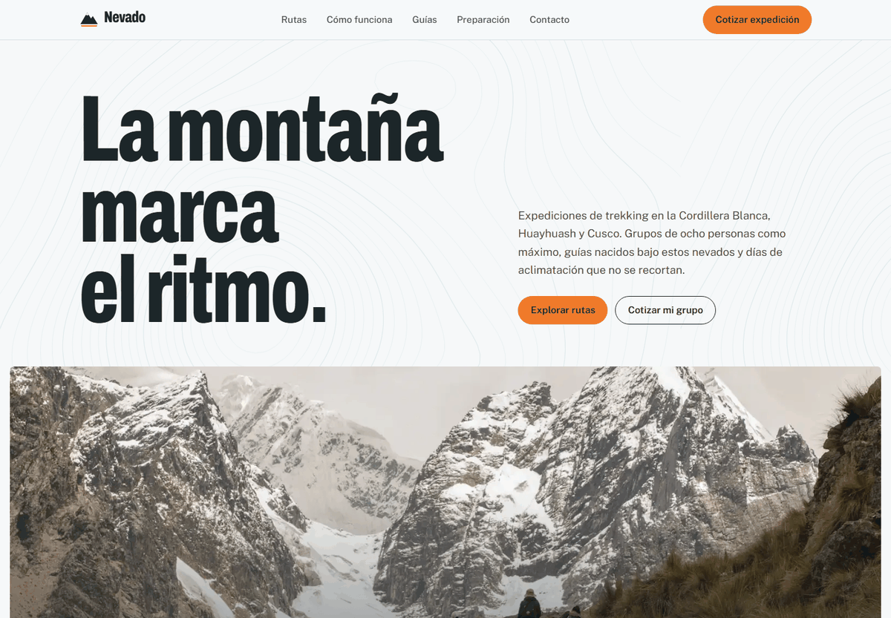

# Nevado: trekking expeditions in the Andes, with the precision of a topographic map

**English** · [Español](README.es.md)

**Live demo:** [nevado-nine.vercel.app](https://nevado-nine.vercel.app/)



**Nevado** is the website of a **fictional** trekking operator based in Huaraz that also runs routes in Cusco. The goal of the site is for visitors to explore the routes, understand how hard they are and **request a quote or book**.

> Portfolio project by Favio ([@Itsfavi0](https://github.com/Itsfavi0)). The company, guides and testimonials are made up. The routes and places are real, but distances, altitudes and prices are approximate. The site is in Spanish.

## What to look at first

1. **The elevation profile**. Each route has its profile drawn in SVG from `[km, altitude]` data. The line draws itself when it enters the screen. On the cards **all profiles share the same vertical scale**, so you can compare Laguna 69 with Ausangate at a glance.
2. **The route explorer** (`#rutas`). Filter by region, difficulty and duration. If no route matches, it suggests which filter to drop and how many routes would appear.
3. **The route detail**. An accessible modal built on the native `<dialog>`: it shows the day-by-day itinerary, the camps, the month-by-month season and what's included. It opens from the button you pressed, traps focus, closes with Esc and returns focus to the button.
4. **The quote calculator** (`#cotizar`). Pick a route, a month (the dry season is highlighted and months without departures are blocked), the number of people and extras, and see the price in S/ and USD with a breakdown. "Pedir esta cotización" fills in the contact form with a summary.

## Sections

| Section | What it does |
|---|---|
| Hero | Headline, CTA and a photo with the Santa Cruz profile on top |
| Why Nevado | Four concrete commitments: groups of 8, acclimatization, measurable safety and responsible tourism |
| Route explorer | 8 routes with filters, profile, technical data and price |
| How it works | A four-stage timeline, from booking to day 1 |
| Quote calculator | Estimated price with a breakdown and a direct path to the form |
| Guides | Fictional team, with no photos of real people |
| Testimonials | One featured testimonial and two secondary ones |
| Preparation and FAQ | Table of available oxygen by altitude, FAQ (`<details>`) and gear list |
| Contact | Form with accessible validation and on-page confirmation |

## Stack

- **React 19** + **Vite 8**
- **Tailwind CSS 4** (tokens in `@theme`, inside `src/index.css`)
- **oxlint** with the `react` and `jsx-a11y` plugins
- Self-hosted fonts via Fontsource: **Archivo** (variable, with a width axis), **Public Sans** and **IBM Plex Mono**
- No animation or component libraries

## Running it

Requires Node 20.19 or later (needed by Vite 8).

```bash
npm install
npm run dev      # http://localhost:5175
npm run build    # outputs dist/
npm run lint
npm run preview  # serves dist/ at http://localhost:5175
```

## Structure

```
nevado/
├─ public/
│  ├─ images/          Unsplash photos recompressed to WebP
│  ├─ topo.svg         generated contour lines (see scripts/)
│  ├─ favicon.svg
│  └─ og-image.jpg
├─ scripts/
│  └─ make_topo.py     generates topo.svg (marching squares over a synthetic terrain)
├─ src/
│  ├─ data/routes.js   the 8 routes: profile, itinerary, season and price
│  ├─ lib/quote.js     quote logic (pure functions)
│  ├─ hooks/           useInView, useElementWidth
│  ├─ components/
│  │  ├─ routes/       RouteExplorer, RouteCard, RouteDialog, RouteFacts
│  │  ├─ ElevationProfile.jsx
│  │  ├─ QuoteCalculator.jsx
│  │  └─ …             one section per file
│  ├─ App.jsx          section order and shared state (route to quote, form prefill)
│  └─ index.css        design tokens and base styles
└─ docs/screenshot.png
```

## Design decisions

- **Concept: "a luminous topographic map".** A snow-white background, large photos and technical data with map-like precision. The elevation profile is the star, and the rest of the design stays restrained so it doesn't compete with it.
- **High-mountain palette**:

  | Token | Color | Use |
  |---|---|---|
  | `snow` | `#F6F8F9` | background |
  | `granite` | `#1C2629` | text and dark sections |
  | `rock` | `#56656B` | secondary text (5.7:1) |
  | `lagoon` | `#0A6E78` | links, secondary buttons, profiles (6:1 against white) |
  | `flare` | `#F07A2A` | CTA, with granite text (5.5:1) |
  | `flare-deep` | `#B44A0C` | orange as text on light backgrounds (5:1) |

- **Typography.** Archivo with its width axis (`font-stretch` 64–80%) for headlines: a condensed grotesque reminiscent of mountain signage. Public Sans for reading and IBM Plex Mono only for technical data (km, m, S/).
- **Real contour lines.** `topo.svg` is not hand-drawn: it is the output of `scripts/make_topo.py`, which traces contours over a synthetic terrain and thickens every fifth line, like on a national survey map. It is applied with `mask-image`, so its color is controlled from CSS.
- **No photos of people for the guides.** Each guide is shown with their initials over a topographic texture, instead of stock photos that would pass for real people.
- **Photos with a fallback.** If a photo fails to load, `Photo.jsx` shows the topographic background at the same size. Choquequirao has no photo on purpose, so the fallback can be seen working.
- **Numbers in Spanish (RAE) style.** `4750 m` with no separator and `12.500` with a period (`Intl.NumberFormat('es-ES')`).

## Technical decisions

- **Native `<dialog>` for the modal.** `showModal()` makes the rest of the page inert, traps focus and closes with Esc without a hand-written focus trap. I intercept the `cancel` event to animate the exit, and the `transform-origin` is computed from the button that opened it.
- **The profile measures its real width** (`ResizeObserver`). That way the `viewBox` matches the pixels, the stroke doesn't distort and the `stroke-dashoffset` animation works at any size. The curve is monotone (Fritsch–Carlson) so no "phantom peaks" appear above the real altitude.
- **No Motion or GSAP.** All the motion fits in CSS (`transform` and `opacity`) plus `IntersectionObserver`, which saves tens of KB of JavaScript.
- **Quote calculator as pure functions** (`lib/quote.js`): season, group discount, per-day extras and USD conversion. Easy to read and to test.
- **Base styles outside `@layer`**: the `body` background, color and typography live outside Tailwind's layers. Unlayered styles always beat layered ones, so if whoever hosts the page injects their own `body { font: 14px … }` (which happens when it is embedded in viewers or previews), the page keeps its typography and background.
- **Minimal shared state in `App.jsx`**: which route is in the calculator and what data prefills the form. The form remounts with a `key` when a new quote arrives, instead of syncing state.

## Accessibility

- Semantic HTML, a single `h1`, headings in order and a "Skip to content" link.
- AA contrast checked on every color pair (the tightest is 5:1).
- Visible focus everywhere. Filters use `aria-pressed` and the results counter uses `aria-live`. When a button disappears after being pressed, focus moves to the counter.
- Modal with trapped focus, closing with Esc or the button, and focus returned afterwards.
- Form with visible `label`s, `aria-invalid` and errors next to each field linked via `aria-describedby`. On submit, focus goes to the first invalid field, or to the confirmation message if everything is valid.
- The SVG profiles have a text summary for screen readers ("50 km, highest point 4750 m at Punta Unión").
- Touch targets of at least 44 px and `prefers-reduced-motion` respected (no animated strokes or reveals).

## Performance

- The 10 photos weigh ≈ 620 KB in total (WebP), with `width`/`height`, `loading="lazy"` below the fold, and the hero photo with `preload` and `srcset`.
- Self-hosted fonts with `font-display: swap` and `unicode-range` subsets.
- Production JS: ~92 KB gzipped (mostly React).

## Image credits (Unsplash)

| Use | Author |
|---|---|
| Hero (hikers in the Cordillera Blanca) | [danny uscamayta](https://unsplash.com/@danny86) |
| Laguna 69 | [Tamara Bravo](https://unsplash.com/@tamiwanders) |
| Santa Cruz | [Edward Blanco](https://unsplash.com/@leblanc_) |
| Huayhuash Circuit | [Wolfgang Lutz](https://unsplash.com/@wolfi) |
| Laguna Churup | [Aarom Ore](https://unsplash.com/@creatorsproduce) |
| Salkantay (Humantay lake) | [Javier Nuñez](https://unsplash.com/@javierportales) |
| Ausangate | [Ausangate Peru](https://unsplash.com/@ausangateperu) |
| Quilcayhuanca – Cojup | [Jacob Vizek](https://unsplash.com/@jakevizek) |
| Contact (sunset in Santa Cruz) | [Marek Piwnicki](https://unsplash.com/@marekpiwnicki) |

All photos are from Peru and are used under the [Unsplash License](https://unsplash.com/license). On the routes they are illustrative: they don't always show the exact spot on the route.

## Future ideas

- Departure calendar with real availability and booking with a deposit (payment gateway in test mode).
- A map of each route with the GPX track and camps synced to the profile (hovering the profile marks the point on the map).
- An English version of the site: many of the people trekking in Huaraz are foreigners.
- Unit tests for `lib/quote.js` with Vitest.
